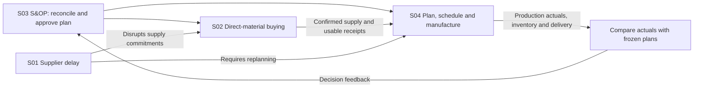

# Scenario map: one world, linked business situations

Updated: 2026-11-15
Status: Planning proposal in PR #21. The user agreed to a scenario hierarchy and explicitly requested direct-material buying, S&OP plan-to-action, and production-plan-to-schedule-to-manufacture-to-plan-comparison coverage. Detailed rules, numerical assumptions, sequencing and implementation remain proposals.

## 1. Structure

**World → end-to-end scenario → linked subscenarios → acceptance evidence → implementation issues.**

An end-to-end scenario is accepted only when its whole business chain executes in the environment. Passing isolated calculations or tool tests does not accept the chain. Subscenarios share actual operational records and state: a confirmed PO creates expected supply; receipts create available material; production consumes material and creates output; output fulfills demand; actuals reconcile against a frozen plan.

Implementation issues own technical work that enables these behaviors. They are not a substitute for business acceptance.

## 2. End-to-end scenario portfolio

| ID | End-to-end scenario | Origin / current detail | Acceptance outcome |
|---|---|---|---|
| S01 | Supplier delay threatens customer delivery | Existing detailed proposal; exact assumptions not yet accepted | Recovery changes arrivals, production, service, inventory and cost over time |
| S02 | Direct-material requirement to buying and usable receipt | Explicit user-requested topic; outline below | A justified purchase becomes a confirmed PO, received material and production-usable stock |
| S03 | S&OP plan to approved operating actions and feedback | Explicit user-requested topic; outline below | A balanced approved plan creates linked purchasing/production actions, then actuals feed the next planning decision |
| S04 | Production plan to schedule to manufacture to comparison against plan | Explicit user-requested topic; outline below | A feasible schedule executes against material/resources; observed output and deviations reconcile to the original plan |
| S05 | Unexpected demand increase | User-confirmed future scenario; implementation sequence not committed | Inventory/capacity allocation responds to changed demand with measurable service/cost effects |
| S06 | Quality hold on material | User-confirmed future scenario; implementation sequence not committed | Affected lots are contained, production impact is assessed and recovery preserves traceability |
| S07 | Transport disruption | User-confirmed future scenario; implementation sequence not committed | Rerouting/allocation changes deliveries and customer commitments under explicit transport constraints |

Only S01 currently has numeric acceptance tables. S02–S04 are outlines to refine, not approved executable specifications. S05–S07 are confirmed future scenarios, with detailed design still to be developed.

## 3. Shared world and links

Use common identities and versions for items/BOMs, suppliers/contracts, locations/lots, orders/receipts, resources/calendars, demand/customer commitments, plans and actual events. Store simulated approval authority where applicable. Do not implement all entities in the first milestone; add only what the accepted scenario requires.

This is a business relationship map, not implementation order. S01 remains the proposed first proof. It can start from predefined orders and production rules without first building full S&OP or sourcing. Later scenarios replace those predefined inputs with actual upstream decisions in the same world.

## 4. S01 linked subscenarios and existing proposed work

The [detailed supplier-delay proposal](dynamic-supplier-delay-v0.1.md) remains the numeric contract under review.

| ID | Linked behavior | State/evidence required | Proposed technical package |
|---|---|---|---|
| S01.1 | Run normal receipts, production and shipments | Business clock, material balances and customer commitment progression | DYN01, DYN02 |
| S01.2 | Process the supplier delay | Existing PO arrival changes; dated notice is visible at the correct time | DYN01, DYN02, DYN03 |
| S01.3 | Assess production/delivery exposure | Agent can inspect requirements, inventory, capacity and available recovery terms | DYN03 |
| S01.4 | Commit a recovery action | Real PO/event/budget change, valid authority and exact-once execution | DYN01, DYN03 |
| S01.5 | Operate and observe consequences | Actual receipts, production, shipments and penalties across the horizon | DYN01, DYN02, DYN03 |
| S01.6 | Compare policies and verify the episode | Independent ledger checks, scenario scorecard, replay and readable experience | DYN04, DYN05 |

DYN identifiers refer to the [issue reconciliation proposal](../planning/2026-11-15-issue-reconciliation-proposal.md); they are not created GitHub issues. S01.3 needs evidence that the tool observations support impact assessment. A scripted baseline may calculate that impact without implying a real LLM has demonstrated the skill.

## 5. S02 — Direct-material buying

Starting situation: a released material requirement tied to a production plan, with known stock, inbound supply, BOM quantities, timing and purchasing authority.

Linked subscenarios:
1. **S02.1 Net the requirement:** distinguish gross demand from usable stock, reservations and timely inbound; identify quantity and need date.
2. **S02.2 Establish sourcing route:** inspect qualified suppliers, contracts/quotes, MOQ, order multiples, lead times and capacities. Decide whether to release against an existing agreement or seek a quote under the stated rules.
3. **S02.3 Evaluate and authorize:** compare feasible landed cost/service options, record missing information or exceptions, and obtain the required simulated approval.
4. **S02.4 Execute the purchase:** create/release a PO and obtain a supplier acknowledgment. A recommendation alone does not complete buying.
5. **S02.5 Receive and establish availability:** process physical receipt, discrepancy and any required quality-release status; only usable accepted quantity becomes available for production.
6. **S02.6 Reconcile:** compare requirement, PO, acknowledgment and receipt, reporting cost, quantity, timing and residual shortages/excess.

Acceptance evidence: identifiers link the requirement through PO/receipt/lot; permissions and commitments are correct; no duplicate purchasing or premature inventory credit; actual usable material can supply S04. Invoice/payment may be a later P2P extension and is not silently required by this outline.

Still to specify: contract versus RFQ scope, approval thresholds, delivery calendars, inspection/rejection rules, price basis and treatment of partial supply.

## 6. S03 — S&OP plan to action

Starting situation: a planning cycle with demand outlook, inventory, supply/resource capacity, open commitments and agreed business objectives.

Linked subscenarios:
1. **S03.1 Establish the baseline:** reconcile inputs, planning versions, units and time buckets; identify data gaps.
2. **S03.2 Reconcile demand and supply:** expose material/capacity/service/financial gaps under the stated assumptions.
3. **S03.3 Evaluate alternatives:** quantify tradeoffs such as inventory, backlog, sourcing changes and capacity adjustments; flag infeasible options.
4. **S03.4 Approve and freeze:** obtain the required simulated decisions and preserve the approved baseline/version.
5. **S03.5 Translate into operating actions:** disaggregate the approved plan under explicit rules into production/material requirements and purchasing/capacity actions feeding S02/S04.
6. **S03.6 Execute and monitor:** observe actual receipts, output, inventory and customer delivery from the operational environment.
7. **S03.7 Compare and respond:** reconcile actuals to the approved baseline, explain evidence-backed deviations and propose/approve a revised plan without erasing the original.

Acceptance evidence: aggregate-to-item/time conversion reconciles; decisions are authorized; plan actions become actual operational commitments; the feedback loop uses recorded actuals. A presentation or spreadsheet containing an unexecuted plan is insufficient.

Still to specify: product-family hierarchy, planning horizon and bucket conversion, decision authority, financial measures, frozen/flexible periods and replanning triggers. These must fit the world's operational time scale.

## 7. S04 — Production plan to schedule to manufacture to plan-versus-actual

Starting situation: an approved item/quantity/date production plan, materials/BOM, routings, resources and shift calendars.

Linked subscenarios:
1. **S04.1 Check readiness:** validate material availability/quality, routing and resource eligibility against the plan.
2. **S04.2 Build the schedule:** allocate orders/operations to resources and time, respecting precedence, capacity, calendars and any declared setup constraints.
3. **S04.3 Authorize and release:** create executable production/work orders and reservations under the stated release rules.
4. **S04.4 Execute manufacture:** advance time, consume material, occupy resources and confirm operation completion/output; model yield, scrap/rework or downtime only where explicitly specified.
5. **S04.5 Respond to variance:** observe a modeled shortage/delay/resource event and revise the remaining schedule within authority, preserving the prior baseline.
6. **S04.6 Compare against plan:** reconcile planned versus scheduled versus actual quantity, start/finish, materials, capacity and cost where modeled. Attribute deviations only when supported by the event trace.
7. **S04.7 Feed outcomes downstream/upstream:** finished stock supports customer delivery and actuals feed S03's next cycle.

Acceptance evidence: a feasible schedule actually executes; inventory/WIP/output and resource occupancy reconcile; plan-versus-actual reporting uses the originally approved version and shows the effect of changes. Publishing a schedule or replacing the baseline with the achieved result does not satisfy this scenario.

Still to specify: time granularity, routing depth, setup/changeover treatment, WIP representation, yield and cost accounting, execution confirmations and allowed replanning.

## 8. Sequence and acceptance discipline

Proposed sequence:
1. Agree and demonstrate S01 end to end, proving the minimum operational clock, events, state consequences and verification.
2. Detail S02 and S04 next; their interfaces can be designed together so purchased material supplies executable production.
3. Add S03 when aggregate-to-operational planning rules and actuals are defined.
4. Consider S05–S07 only after the earlier chains work and priorities are explicitly chosen.

This order is a recommendation, not a new user-approved schedule. S03 is upstream in business logic but does not need full implementation before a small operational proof.

For every scenario freeze the initial situation, visible information, actions/authority, transitions, timing, constraints, alternative valid policies, metrics, baseline and negative cases before implementation. Keep subscenario-level checks and one parent-level executed acceptance trace. Holdout worlds and disruptions must be assigned before collection; public acceptance fixtures are not sealed benchmark tasks.

The next decision remains acceptance/revision of S01's concrete rules, followed by one coherent backlog reconciliation. This scenario map expands planning coverage; it authorizes no new implementation, paid runs, corpus collection or merges.
