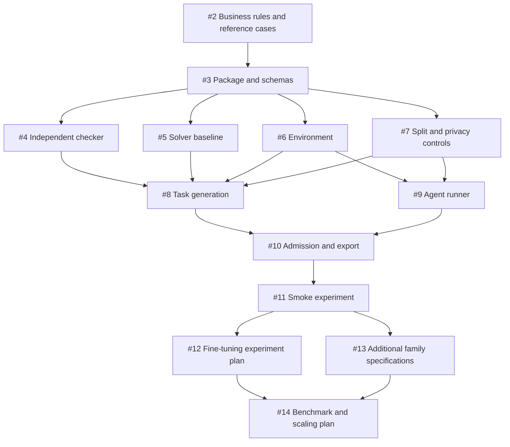

# Execution roadmap

Last updated: 2026-11-02

[Milestone epic #1](https://github.com/kishorkukreja/SupplyChainWorld/issues/1) tracks the first verified supplier-allocation environment. [spec.md](spec.md) is its implementation baseline; [PRD.md](PRD.md) retains the broader product scope.

## Issue sequence

| Issue | Deliverable | Prerequisites |
|---|---|---|
| [#2](https://github.com/kishorkukreja/SupplyChainWorld/issues/2) | Specify supplier-allocation rules and ten reference cases | None — ready |
| [#3](https://github.com/kishorkukreja/SupplyChainWorld/issues/3) | Establish package, versioned schemas and offline CI | #2 |
| [#4](https://github.com/kishorkukreja/SupplyChainWorld/issues/4) | Implement independent award and exception verification | #3 |
| [#5](https://github.com/kishorkukreja/SupplyChainWorld/issues/5) | Implement reference optimizer and heuristic baseline | #3 |
| [#6](https://github.com/kishorkukreja/SupplyChainWorld/issues/6) | Build resettable procurement environment and visible artifacts | #3 |
| [#7](https://github.com/kishorkukreja/SupplyChainWorld/issues/7) | Implement lineage splits and private evaluation boundaries | #3 |
| [#8](https://github.com/kishorkukreja/SupplyChainWorld/issues/8) | Generate and validate diverse procurement task instances | #4, #5, #6, #7 |
| [#9](https://github.com/kishorkukreja/SupplyChainWorld/issues/9) | Build agent runner, adapters and observable trajectory capture | #6, #7 |
| [#10](https://github.com/kishorkukreja/SupplyChainWorld/issues/10) | Add probe repair, admission and verified training export | #8, #9 |
| [#11](https://github.com/kishorkukreja/SupplyChainWorld/issues/11) | Run the procurement smoke experiment and report the scale decision | #10 |
| [#12](https://github.com/kishorkukreja/SupplyChainWorld/issues/12) | Design the first fine-tuning learning-curve experiment | #11 |
| [#13](https://github.com/kishorkukreja/SupplyChainWorld/issues/13) | Specify expansion to replenishment, purchase-to-pay and disruption workflows | #11 |
| [#14](https://github.com/kishorkukreja/SupplyChainWorld/issues/14) | Define benchmark v1 and evidence-based production scaling gates | #12, #13 |

Issues #2–#11 implement and evaluate the first procurement milestone. Issues #12–#14 plan subsequent training, workflow expansion, and benchmark scaling; they do not authorize immediate large-scale generation or paid runs.

## Dependency map

## Working agreement

- Start with #2. Resolve business semantics before encoding them into schemas or graders.
- After #3, checker, baseline, environment, and split controls can be developed independently against the agreed contracts. This describes dependency order, not a commitment to parallel staffing.
- Every issue includes acceptance criteria, expected artifacts, prerequisite links, and completion evidence.
- Dependencies are maintained as explicit links/checklists. Native GitHub blocking relationships were not configured because the available connector does not support them.
- Use issue-specific branches and PRs. Resolve prerequisites before dependent implementation; record any agreed provisional work.
- Update progress.md and the epic checklist after accepted milestones. Issue closure alone is insufficient without linked evidence.
- Do not assign deadlines, spend money, claim domain signoff, or publish private test data implicitly.

